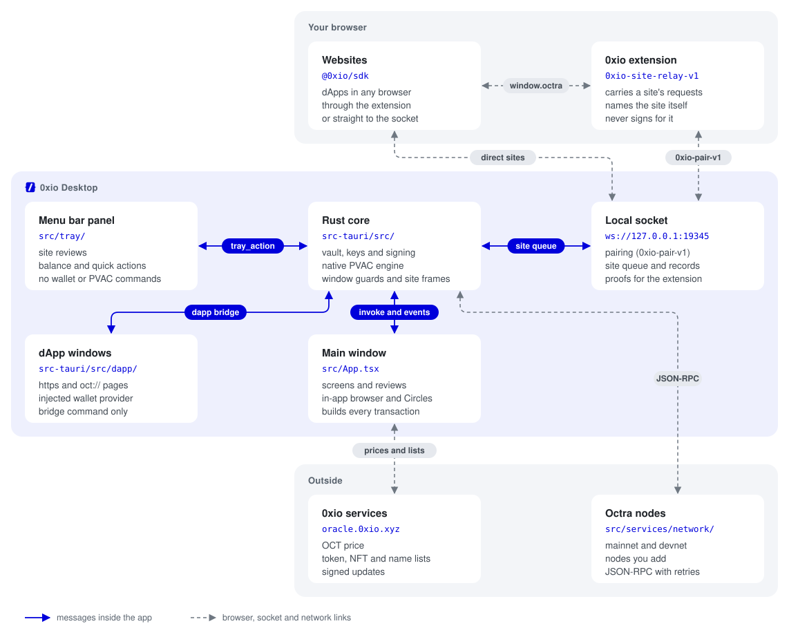

<p align="center">
  <picture>
    <source media="(prefers-color-scheme: dark)" srcset="docs/img/lockup-white.svg">
    
  </picture>
</p>

<p align="center">
  <a href="https://github.com/0xio-xyz/0xio-desktop-app/actions/workflows/ci.yml"></a>
  <a href="LICENSE"></a>
  <a href="https://x.com/0xio_xyz"></a>
</p>

# 0xio Desktop

Non-custodial desktop wallet for the Octra Network that lives in the menu bar: keys, signing and the PVAC-HFHE privacy engine run natively in Rust on your computer, and websites in any browser can sign with it through the 0xio extension or straight over a local socket.

- **Version:** 0.7.4
- **Platform:** macOS 13 or later (Apple silicon and Intel) and Windows; Linux builds from source
- **Built with:** Tauri 2, Rust, React 18 and TypeScript
- **License:** [MIT](LICENSE)
- **Copyright:** (C) 2025-2026 0xio Labs

## Install

- [0xio.xyz/install](https://0xio.xyz/install) for macOS (one universal build for Apple silicon and Intel) and Windows

Installed copies update themselves: every update is verified against a bundled minisign key before it installs. To run the code in this repository instead, build it from source.

## Build from source

Prerequisites: Node 22 (`.nvmrc`), a stable Rust toolchain and the [Tauri 2 prerequisites](https://v2.tauri.app/start/prerequisites/) for your platform.

```bash
npm ci
npm run tauri:dev      # run the app
npm run tauri build    # installer -> src-tauri/target/release/bundle/
```

The privacy engine comes from the `pvac-rs` and `pvac-handler` crates, which are not public. Without them only the front end builds and tests (`npm run build`, `npm test`).

Releases ship one macOS build for both Apple silicon and Intel: `rustup target add aarch64-apple-darwin x86_64-apple-darwin`, then `npm run tauri build -- --target universal-apple-darwin`. On Windows the installer is `bundle/msi/*.msi`; on Linux `bundle/appimage/*.AppImage` and `bundle/deb/*.deb`.

The checks to run before a pull request are in [CONTRIBUTING.md](CONTRIBUTING.md).

## Features

- **Non-custodial:** keys are sealed in a local vault (AES-256-GCM, PBKDF2-SHA256 with 600,000 iterations) and never leave Rust; the window names a wallet and Rust signs.
- **Menu bar wallet:** closing the window keeps 0xio Desktop running in the menu bar. The panel shows the balance, sends with a review, receives with a QR code, claims, encrypts and decrypts, and reads loose commands such as `send 10 to 0xio privately`.
- **Encrypted balances (PVAC-HFHE):** move OCT between a public and an encrypted balance, send privately to stealth addresses and claim what arrives. Proofs run in native Rust threads, one job at a time in a visible queue.
- **Sites from any browser:** websites sign here through the paired 0xio extension or straight from their own `https` origin over `ws://127.0.0.1:19345`. Every request is reviewed in the menu bar.
- **In-app browser and Circles:** dApps in a built-in browser or their own windows, and on-chain `oct://` sites (Octra Circles) with publishing of your own.
- **Contracts:** an editor for AML contracts with files on disk, build, audit, deploy and call, an assistant with your own model keys, and a contracts list.
- **Wallet:** several wallets (create, import, derive, watch-only), send to one or many, history per network, NFTs, ONS names on devnet, an address book and a notification centre.
- **Touch ID and Windows Hello:** unlock with a fingerprint; on macOS the password sits in a keychain item only a current fingerprint opens.
- **Localized:** English, Indonesian, Chinese, Japanese and Korean.

The full list by area is in [docs/ui.md](docs/ui.md), [docs/privacy.md](docs/privacy.md) and [docs/sites.md](docs/sites.md).

## Architecture

<p align="center">
  
</p>

0xio Desktop is a Tauri 2 app: one Rust process and several web views. Only the Rust core holds secrets; each window gets the commands it needs and nothing more.

### Rust core

`src-tauri/src/`, set up in `lib.rs`, which lists every command. It holds the vault and signs (`wallet/`), runs the PVAC engine on a thread pool (`pvac/`), serves the local socket and pairing (`ws/`), keeps the records of connected sites and serves sandboxed frames for living NFTs and `oct://` pages (`sites/`), sends node calls (`net/`), owns the menu bar icon and panel (`system/tray.rs`) and checks which window called (`guard/`). See [docs/core.md](docs/core.md).

### Main window

`index.html` -> `src/main.tsx` -> `src/App.tsx`, React 18 with screens in `src/features/`. It owns the wallet state, builds every transaction, shows every review and answers site requests through its dApp handler (`src/features/dapp/services/dappRequest.ts`). It asks Rust to sign and to prove; it never sees a private key. See [docs/ui.md](docs/ui.md) and [docs/transactions.md](docs/transactions.md).

### Menu bar panel

`tray.html` -> `src/tray/`. The main window publishes a snapshot of its state to Rust (`tray_publish`); the panel reads it and asks for changes (`tray_action`), which Rust forwards to the main window. The panel gets no wallet, PVAC or file commands, and a password typed in it is checked in Rust and never reaches another window. Site reviews open here.

### dApp windows

`src-tauri/src/dapp/`. An `https` site or an `oct://` page can open in its own window with an injected wallet provider. These windows may call one command, `dapp_bridge_request`; Rust reads the site from the window's URL, never from the page, and the main window answers. See [docs/sites.md](docs/sites.md).

### Local socket and the extension relay

`src-tauri/src/ws/` listens on `ws://127.0.0.1:19345`. The 0xio extension pairs once (`0xio-pair-v1`) and proves the pairing on every connection; it can then send its PVAC proofs here and relay sites that sign with 0xio Desktop (`0xio-site-relay-v1`). Web pages may connect from their own `https` origin and send site requests only ([docs/DIRECT_SITES.md](docs/DIRECT_SITES.md)). Each request waits in a queue and is reviewed in the menu bar.

The protocol overview (keys, vault, PVAC, signing, the permission model, networks and the socket) is [docs/ARCHITECTURE.md](docs/ARCHITECTURE.md). Language files are covered in [docs/translation.md](docs/translation.md).

## Integrating with 0xio Desktop

Use the SDK, [`@0xio/sdk`](https://www.npmjs.com/package/@0xio/sdk) ([source](https://github.com/0xio-xyz/0xio-sdk)). It finds the 0xio extension, 0xio Desktop or the 0xio App on its own and picks the transport, so the same code works in each.

```bash
npm install @0xio/sdk
```

```ts
import { ZeroXIOWallet } from '@0xio/sdk';

const wallet = new ZeroXIOWallet({
  appName: 'My DApp',
  requiredPermissions: ['accounts', 'public_transactions'],
});

await wallet.initialize();
const { address } = await wallet.connect();
```

A site reaches 0xio Desktop in one of three ways:

- **Through the 0xio extension:** the user picks 0xio Desktop for the site in the extension. The extension names the site from the browser and carries its Octra requests over its pairing; it never signs for that site itself. The protocol is the extension's [DESKTOP_RELAY.md](https://github.com/0xio-xyz/0xio-wallet/blob/main/docs/DESKTOP_RELAY.md).
- **Straight from the browser:** the page opens `ws://127.0.0.1:19345` from its own `https` origin and sends `site_request` messages. An approved connect returns a site token that proves the site on later connections. The protocol is [docs/DIRECT_SITES.md](docs/DIRECT_SITES.md).
- **Inside 0xio Desktop:** pages in the in-app browser and in dApp windows talk to the wallet over the provider's message channel (`window.octra`, `window.wallet0xio`).

Every connect, signature, send and network switch opens a review in 0xio Desktop. Requests that carry a request id follow wallet protocol 2: status reads, events and the same answer for a repeated id ([docs/sites.md](docs/sites.md)).

## Security

- Private keys never leave Rust. No command returns a key or phrase except the two export commands behind the password, and a test fails if one ever does.
- The vault is AES-256-GCM under a key derived from the password with PBKDF2-SHA256 (600,000 iterations), written atomically, readable by this user only, with the previous copy kept as `vault.json.bak`.
- After 5 failed unlocks the password waits 30 seconds, doubling with each further miss up to an hour. Auto-lock is enforced in Rust as well as in the window.
- Every app command needs a capability: the main window gets what it uses, the menu bar panel a short list, dApp windows only the bridge; wallet commands also refuse any caller but the main window.
- Untrusted content (living NFTs, `oct://` pages) loads in opaque-origin sandboxes from a listener on `127.0.0.1`, with a Content Security Policy of its own and no command access.
- Updates are verified against a bundled minisign key, each bound to its version.

Found a vulnerability? Report it privately as described in [SECURITY.md](SECURITY.md).

## Contributing

Contributions are welcome under MIT; see [CONTRIBUTING.md](CONTRIBUTING.md) and the [code of conduct](CODE_OF_CONDUCT.md). Version history is in [CHANGELOG.md](CHANGELOG.md).

## License

MIT; see [LICENSE](LICENSE). Bundled third-party components, including the PVAC engine credit and the fonts, are listed in [THIRD_PARTY_NOTICES.md](THIRD_PARTY_NOTICES.md).
